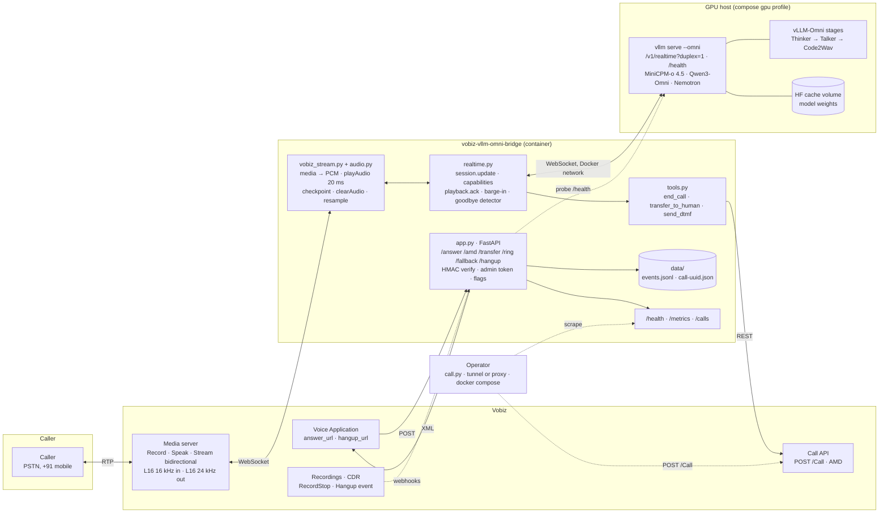
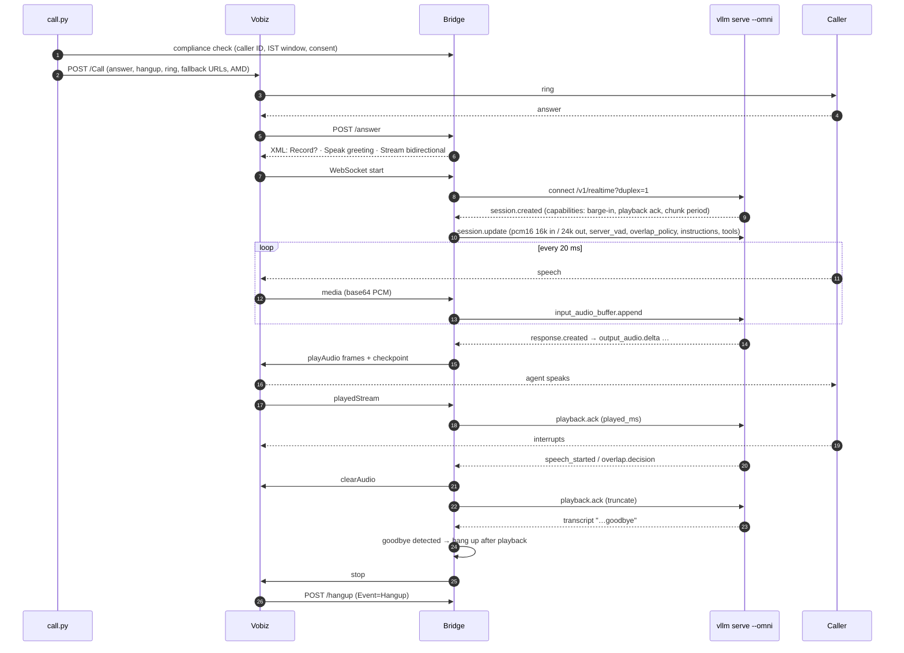

# vobiz-vllm-omni-bridge

Run an open-weight speech-to-speech model on your own GPU and put it on a real
phone number. The bridge connects a [Vobiz](https://www.vobiz.ai) bidirectional
`<Stream>` to a self-hosted [vLLM-Omni](https://github.com/vllm-project/vllm-omni)
full-duplex session. No model API, no per-minute vendor bill, audio never
leaves your host.

[](https://github.com/vobiz-ai/vobiz-vllm-omni-bridge/actions/workflows/ci.yml)
[](./LICENSE)
[](https://www.python.org/downloads/)

```text
phone <-- RTP --> Vobiz <-- WebSocket --> bridge <-- WebSocket --> vllm serve --omni (your GPU)
```

Looking for the hosted version on Sprag? That is
[vobiz-omni-bridge](https://github.com/vobiz-ai/vobiz-omni-bridge). This repo
is the self-hosted sibling: same Vobiz side, same flags, one model backend.

## What you get

- **One `docker compose up`** that starts the model server on your GPUs and
  the bridge beside it. MiniCPM-o 4.5 by default; Qwen3-Omni and Nemotron
  VoiceChat through the same compose file.
- **Every Vobiz feature as a flag.** Audio formats, greeting, recording,
  answering machine detection, transfer, DTMF, India calling rules, HMAC
  verification, concurrency caps, watchdogs, metrics.
- **The duplex protocol done properly.** `playback.ack` from Vobiz checkpoints,
  barge-in from `speech_started` or `overlap.decision`, capability checks on
  `session.created`, and a goodbye detector for models that cannot call tools.
- **No GPU needed to test.** A mock duplex server, a mock Vobiz caller and 44
  tests run on a laptop and in CI.

## Quick start

On a host with an NVIDIA GPU, Docker and the NVIDIA Container Toolkit:

```bash
git clone https://github.com/vobiz-ai/vobiz-vllm-omni-bridge.git
cd vobiz-vllm-omni-bridge
cp .env.example .env            # VOBIZ_AUTH_ID, VOBIZ_AUTH_TOKEN, FROM_NUMBER, TO_NUMBER, HF_TOKEN
docker compose --profile gpu up -d --build
docker compose logs -f vllm-omni   # first start downloads the weights; wait for "Application startup complete"
curl -s localhost:8000/health | jq '.omni, .model'
docker compose run --rm call       # dial TO_NUMBER
```

With `PUBLIC_URL` empty the bridge opens a Cloudflare quick tunnel so Vobiz
can reach it. For a stable hostname, inbound calls, and the production flags,
see [docs/deployment.md](docs/deployment.md).

Already running `vllm serve ... --omni` somewhere else? Skip the `gpu`
profile and set `REALTIME_URL=ws://<host>:8091/v1/realtime?duplex=1`.

### Without Docker

```bash
pip install -r requirements.txt
cp .env.example .env
python app.py                   # bridge on :8000, starts cloudflared if PUBLIC_URL is empty
python call.py                  # outbound call with AMD, ring and hangup callbacks
```

The model server runs separately:

```bash
vllm serve openbmb/MiniCPM-o-4_5 --omni --trust-remote-code --port 8091
```

### Inbound calls

Create a Voice Application in the Vobiz Console with
`answer_url = https://<your host>/answer` and `hangup_url = https://<your host>/hangup`,
attach a number, and call it.

## Models

| Model | Duplex | Barge-in | Tool calls | GPU | Notes |
|---|---|---|---|---|---|
| `openbmb/MiniCPM-o-4_5` (default) | yes | yes | no | 1 × 80 GB for 16 sessions | Decides once per second (`chunk_period_ms` 1000). Ends calls through `END_CALL_ON_GOODBYE`. |
| `Qwen/Qwen3-Omni-30B-A3B-Instruct` | yes, with `--deploy-config qwen3_omni_duplex.yaml` | yes | no | 2 × 80 GB | 10 spoken languages. |
| Nemotron VoiceChat | yes, with its deploy config | no | yes | 1 × 80 GB | 22.05 kHz output; the only one that can call `end_call` and `transfer_to_human`. |

Details, VRAM and the exact serve commands are in [docs/models.md](docs/models.md).
The bridge branches on the `capabilities` object the server returns, never on
the model name, so a new duplex model works without a code change.

## Architecture



Three planes run through that picture:

| Plane | Protocol | What moves |
|---|---|---|
| Control | HTTPS | Vobiz webhooks in (`/answer`, `/amd`, `/hangup`, `RecordStop`), XML and REST out (transfer, hangup, DTMF, make-call) |
| Media | WebSocket, RTP | One Vobiz stream and one duplex session per call. PCM both ways, 20 ms frames out, `checkpoint` → `playback.ack`, `clearAudio` on barge-in |
| Ops | HTTP, files | `/health` (including a probe of the model server), `/metrics`, `/calls`, `events.jsonl`, the dialer, the tunnel |

### One call, end to end



Models that advertise tool calling (Nemotron VoiceChat) end the call through
`end_call` instead of the goodbye detector; the bridge decides from the
`capabilities` object on `session.created`, never from the model name.

## What happens on the call

1. Optional `<Record>` with a spoken disclosure, then a greeting from Vobiz
   `<Speak>` (default) or from the model itself (`GREETING_SOURCE=model`, sent
   as `duplex_initial_user_text`).
2. A bidirectional stream, 16 kHz linear PCM in and 24 kHz out by default, so
   nothing is resampled. Mu-law 8 kHz on either leg is a flag.
3. One `session.update` configures the duplex session: formats, `server_vad`,
   `overlap_policy: barge_in_on_speech`, instructions, tools.
4. Replies go out as 20 ms `playAudio` frames with a `checkpoint` after each.
   Vobiz's `playedStream` becomes a full `playback.ack` to the model.
5. Barge-in: `speech_started` or an `overlap.decision` during playback becomes
   `clearAudio` plus a truncated `playback.ack`. A protect window stops the
   caller's "hello?" on pickup from cutting the greeting.
6. The call ends when the model calls `end_call`, when the agent's transcript
   contains a goodbye phrase, when a watchdog fires, or when Vobiz posts
   `Event=Hangup`.

## Configuration

Every setting is an environment variable, read once at startup, validated, and
shown on the banner and `GET /health`. `.env.example` lists all of them.

| Group | Flags | What it controls |
|---|---|---|
| Model | `REALTIME_URL`, `OMNI_MODEL`, `OMNI_HEALTH_URL`, `REALTIME_API_KEY`, `REQUIRE_DUPLEX`, `VOICE`, `TEMPERATURE`, `MAX_OUTPUT_TOKENS`, `INPUT_TRANSCRIPTION`, `VAD_*`, `MODEL_CONNECT_RETRIES` | which server, which model, how turns are detected |
| Compose gpu profile | `OMNI_IMAGE_TAG`, `OMNI_PORT`, `OMNI_GPUS`, `OMNI_EXTRA_ARGS`, `HF_TOKEN`, `HF_HOME` | how the model server container starts |
| Persona | `PERSONA` (generic, india-clinic), `AGENT_GREETING`, `AGENT_SYSTEM_PROMPT` | what the agent says |
| Audio | `STREAM_CONTENT_TYPE`, `OUTPUT_CONTENT_TYPE`, `OUTPUT_SAMPLE_RATE`, `MODEL_INPUT_RATE`, `VOBIZ_L16_ENDIAN`, `PLAY_CHUNK_MS`, `GATE_ON_CLEARED_AUDIO` | stream formats both ways |
| Barge-in | `BARGE_IN_PROTECT_MS`, `INTERRUPT_RESPONSE` | when caller speech cancels a reply |
| Greeting | `GREETING_SOURCE` (speak, model, none), `SPEAK_VOICE`, `SPEAK_LANGUAGE` | who greets, before or inside the session |
| Recording | `RECORD_CALLS`, `RECORD_FORMAT`, `RECORD_MAX_LENGTH`, `RECORD_TRANSCRIBE`, `RECORD_DISCLOSURE` | `<Record recordSession>` before the stream |
| Stream | `STREAM_MAX_RETRIES`, `STREAM_TIMEOUT_S`, `STREAM_STATUS_CALLBACKS`, `STREAM_EXTRA_HEADERS` | `<Stream>` attributes |
| AMD | `AMD_MODE`, `AMD_ON_MACHINE`, `AMD_HOLD_BEFORE_AGENT`, `AMD_*_MS`, `AMD_MAXIMUM_WORDS`, `VOICEMAIL_MESSAGE`, `VOICEMAIL_WAIT_S` | answering machine detection on outbound calls |
| Call ending | `TOOL_END_CALL`, `TOOL_TRANSFER` + `TRANSFER_NUMBER`, `TOOL_SEND_DTMF`, `DTMF_TO_MODEL`, `END_CALL_ON_GOODBYE`, `GOODBYE_PHRASES` | tools for models that have them, goodbye detection for models that do not |
| Call | `CALLER_NAME`, `TIME_LIMIT_S`, `RING_CALLBACKS`, `SEND_DIGITS` | make-call parameters |
| Compliance | `REGION`, `CAMPAIGN_TYPE`, `ENFORCE_CALLING_WINDOW`, `CONSENT_REQUIRED`, `REQUIRE_INDIA_CALLER_ID` | India calling window, consent, caller ID |
| Security | `VERIFY_SIGNATURES`, `ADMIN_TOKEN`, `WS_PATH_SECRET` | HMAC on callbacks, admin routes, secret stream path |
| Ops | `MAX_CONCURRENT_CALLS`, `MAX_CALL_SECONDS`, `CALLER_SILENCE_HANGUP_S`, `CHECKPOINT_TIMEOUT_S`, `JSON_LOGS`, `EVENTS_JSONL` | capacity, watchdogs, logging |
| Server | `HTTP_PORT`, `PUBLIC_URL`, `TUNNEL_TOKEN` | how Vobiz reaches the bridge |

Keep `MAX_CONCURRENT_CALLS` at or below the model server's
`duplex_session.max_sessions`; the bridge plays a busy message to the caller
above its own cap, while the server closes extra sessions with code 1013.

## Test without a GPU or a phone

```bash
python -m pytest -q                                    # 44 tests
python selftest.py --mock --mock-port 8791              # mock duplex server + mock caller through the real app
python selftest.py --mock --barge-in
python selftest.py --persona india-clinic               # against the server in .env, still with a mock caller
docker compose run --rm test
```

`mock_realtime.py` speaks the duplex dialect: it advertises capabilities on
`session.created`, replies with tone audio and a transcript, honours
`playback.ack`, and `--no-capabilities` lets you see what the bridge does when
pointed at a turn-based server.

## Observability

- `GET /health`: model, server URL, a cached probe of the server's `/health`,
  active calls, and every non-secret flag. The Docker health check uses it.
- `GET /metrics`: Prometheus text.
- `GET /calls`, `GET /flags`: admin views behind `ADMIN_TOKEN`.
- `data/events.jsonl` and `data/call-<uuid>.json`: every event with timestamps,
  including `model:session.created` with the capabilities the server returned.

## Files

| File | Role |
|---|---|
| `config.py` | every flag, parsed and validated once |
| `personas.py` | `generic` and `india-clinic` |
| `app.py` | FastAPI routes: answer, AMD, voicemail, transfer, stream, recording, ring, hangup, health, metrics |
| `realtime.py` | the duplex session: handshake, capabilities, audio pump, barge-in, playback acks, goodbye detection |
| `vobiz_stream.py` | `playAudio`, `checkpoint`, `clearAudio`, `playedStream` timeouts |
| `vobiz_api.py` | make-call with AMD, transfer, hangup, DTMF, signature verification, compliance |
| `tools.py` | `end_call`, `transfer_to_human`, `send_dtmf` |
| `audio.py` | mu-law, byte order, resampling |
| `call.py` | outbound dialer |
| `mock_realtime.py`, `mock_vobiz.py`, `selftest.py` | GPU-less and phoneless testing |
| `docker-compose.yml` | model server (gpu profile), bridge, tunnel, call and test profiles |
| `docs/deployment.md`, `docs/models.md` | hosts, GPUs, tunnels, production flags; per-model serve commands |

## Known limits

- MiniCPM-o 4.5 has no tool calling, so `end_call` and `transfer_to_human`
  are never invoked by it. The goodbye detector ends calls; transfer needs a
  model with tools (Nemotron VoiceChat) or an operator action.
- MiniCPM-o decides once per second, so replies start later than a hosted
  Symphony session; expect roughly one second to first audio.
- The duplex models speak English and Chinese well. Hindi output is not
  available; the India persona understands Hindi and replies in English.
- Async AMD keeps state in memory, so a multi-instance bridge needs sticky
  sessions or `AMD_MODE=sync`.
- Not yet exercised on a live PSTN call from this repo: the same Vobiz
  protocol code was verified live from the hosted sibling, and the duplex
  dialect is verified against the mock server. A live run against
  `vllm serve --omni` on a GPU host is the first thing to do after deploy.

## Contributing and security

See [CONTRIBUTING.md](CONTRIBUTING.md) and [SECURITY.md](SECURITY.md).

## License

MIT. See [LICENSE](LICENSE).
